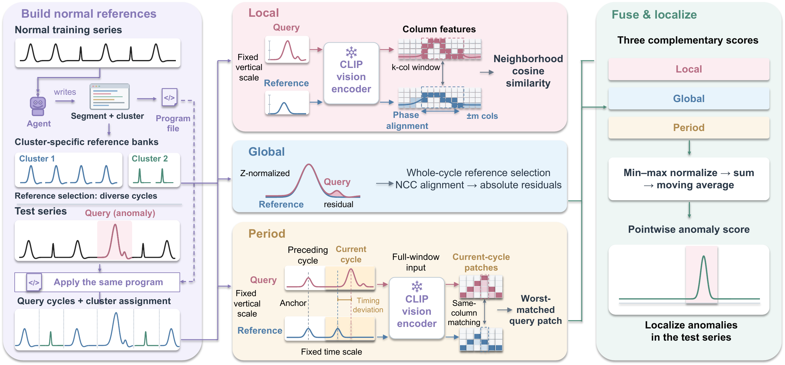

# ✨ TRACE-AD 🔍

**📈 Reference-Guided Visual Anomaly Detection for Quasi-Periodic Time Series 🔁**

Welcome! 👋 This repository accompanies the paper (currently under double-blind
review 🙈) and contains the code and prompts to reproduce the method. We kept it
tidy so you can get started fast. 🚀

## 🗺️ How TRACE-AD works

> 🧩 **Figure 3 — Overview.** Agent-assisted cycle segmentation and two-stage
> clustering organize normal training cycles into pattern-specific reference banks.
> Query cycles are compared with the corresponding references through the **Local**
> 🔴, **Global** 🔵, and **Period** 🟡 channels, whose scores are fused into a
> pointwise anomaly score for localization. 🎯

## 📦 Repository structure

- 🧠 `detection/` — the TRACE-AD detection pipeline: cycle rendering, a frozen CLIP
  vision encoder, three complementary comparison channels (Local / Global / Period),
  fusion, localization, and evaluation.
- ✂️ `segmentation/` — per-dataset cycle segmentation programs. Each dataset folder
  provides a `core.py` segmentation/clustering engine and per-series configuration
  files (`<id>.py`) that call it.
  - 🏥 UCR Anomaly Archive domains: `ECG`, `ABP`, `RESP`, `Gait`, `NASA_Data`,
    `Power_Demand`, `EPG`, `Air_Temperature`, `Acceleration_Sensor_Data`
  - 🗂️ TSB-AD-U subsets: `SED`, `SVDB`, `MITDB`
  - 🧪 Synthetic: `SRW`
- 🤖 `prompts/` — the LLM agent prompts used to develop and review the segmentation
  programs (`development_agent.md`, `evaluation_agent.md`,
  `cluster_count_resolution.md`, `segmentation_prompt.md`).

## 💾 Data

Place the datasets under `./data/` (e.g., `./data/UCR_Anomaly_FullData`,
`./data/TSB-AD-U`, `./data/SRW`) to match the `DATA_DIR` values in the segmentation
`core.py` files, or edit those paths to your location. 📂

## ▶️ Usage

See 🧠 `detection/README.md` for running the detection pipeline, and
✂️ `segmentation/<dataset>/` for the segmentation programs. Happy detecting! 🕵️

## 📜 License

Released under the MIT License (see `LICENSE`). 🆓 Third-party components used for
evaluation are listed in `detection/NOTICE`.
